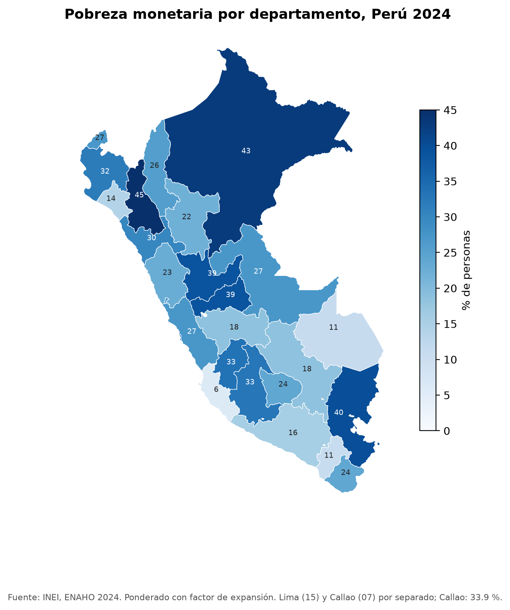
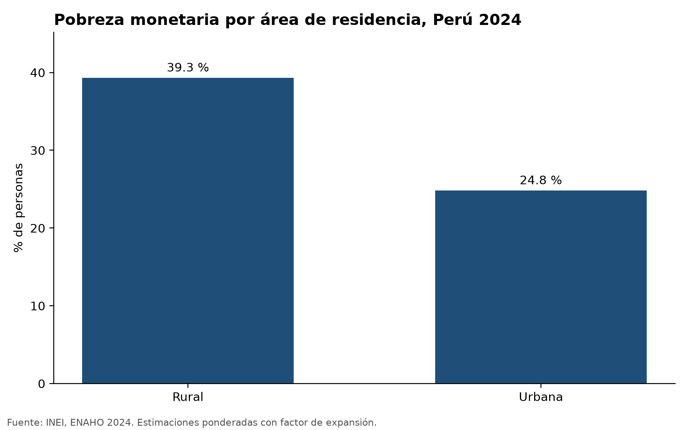
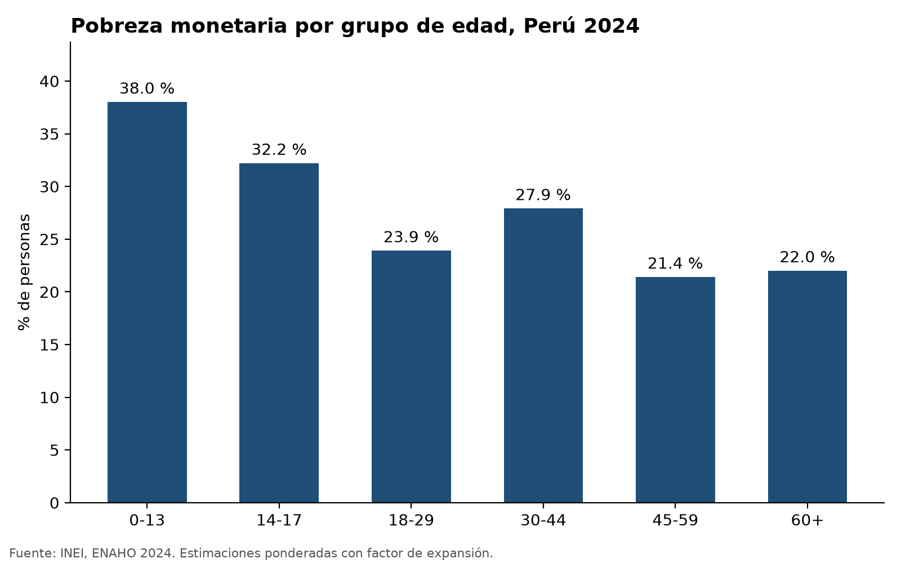

# Skills para la ENAHO

Cuatro skills de Claude Code que descargan, limpian, grafican y mapean la ENAHO 2024 del INEI
siempre de la misma forma. La limpieza replica la pobreza monetaria oficial: **27.6 %**.



## Las skills

| Skill | Entra | Sale |
|---|---|---|
| `descargando-enaho` | año (2015–2024) y módulos | `datos/*.dta`, `datos/peru_departamental_simple.geojson` |
| `limpiando-enaho` | `sumaria-2024.dta`, `enaho01-2024-200.dta` | `salidas/personas_2024.parquet`, `salidas/validacion.txt` |
| `graficando-enaho` | base limpia y una variable (área, sexo, edad, departamento) | `figuras/*.png` |
| `mapeando-enaho` | base limpia y GeoJSON de los 25 departamentos | `mapas/pobreza_departamento.png` |

Se encadenan solas: si falta la base limpia, graficar o mapear usan primero `limpiando-enaho`,
y si faltan los datos, esta usa `descargando-enaho`. Un solo pedido como
«haz un mapa de la pobreza por departamento» puede activar tres skills seguidas.

```
.claude/skills/
├── descargando-enaho/   SKILL.md · scripts/descargar.py
├── limpiando-enaho/     SKILL.md · reference.md · scripts/limpiar.py
├── graficando-enaho/    SKILL.md · scripts/graficar.py
└── mapeando-enaho/      SKILL.md · scripts/mapear.py
salidas/validacion.txt · figuras/ · mapas/ · evaluacion.md · evaluar.py
```

## Cómo correrlo

Requiere [uv](https://docs.astral.sh/uv/) y [Claude Code](https://code.claude.com).

```bash
git clone https://github.com/LuisGuevaraVega/skills_enaho.git
cd skills_enaho
uv sync
```

**Con Claude Code** (las skills se activan solas):

```bash
claude
> Haz un mapa de la pobreza por departamento con la ENAHO 2024
> /limpiando-enaho 2024
```

**Sin Claude**, los mismos pasos a mano:

```bash
uv run .claude/skills/descargando-enaho/scripts/descargar.py --anio 2024   # ~22 MB del INEI a datos/
uv run .claude/skills/limpiando-enaho/scripts/limpiar.py --anio 2024
uv run .claude/skills/graficando-enaho/scripts/graficar.py --por area
uv run .claude/skills/mapeando-enaho/scripts/mapear.py
```

Los datos vienen de `proyectos.inei.gob.pe/iinei/srienaho/descarga/STATA/966-Modulo34.zip`
y `966-Modulo02.zip` (966 = ENAHO 2024). `datos/` no se sube a GitHub.

## Validación

El pipeline de `limpiar.py` sigue siempre el mismo orden: leer con las llaves como texto,
normalizar nombres («aÑo» → `anio`), quedarse con los residentes habituales, unir personas
y hogares con `validate="m:1"`, construir variables, validar y guardar.

| Indicador | Obtenido | INEI |
|---|---|---|
| Pobreza monetaria (sumaria, `factor07 × mieperho`) | 27.58 % | 27.6 % |
| Pobreza extrema | 5.50 % | 5.5 % |
| Residentes habituales | 108,664 | 108,664 |
| Departamentos con dato en el mapa | 25 | 25 |

Detalle completo en [`salidas/validacion.txt`](salidas/validacion.txt).

**Ponderación.** Para departamento y área (variables del hogar) se pondera como el INEI:
un registro por hogar con `factor07 × mieperho`. Para sexo y edad (variables de la persona)
se usa `facpob07`. Con `facpob07` en toda la base, la pobreza nacional da 27.53 %.

## Resultados

| Pobreza 2024 | % |
|---|---|
| Urbana / rural | 24.8 / 39.3 |
| Cusco | 18.5 |
| Más pobres | Cajamarca 45.0, Loreto 43.0, Puno 39.9 |
| Menos pobres | Ica 6.0, Moquegua 11.0, Madre de Dios 11.1 |

<p>


</p>

## Evaluación

[`evaluacion.md`](evaluacion.md) compara los tres pedidos de la sesión con y sin skills
(`claude -p` y `claude -p --disallowedTools Skill`). `uv run evaluar.py` los corre todos.
